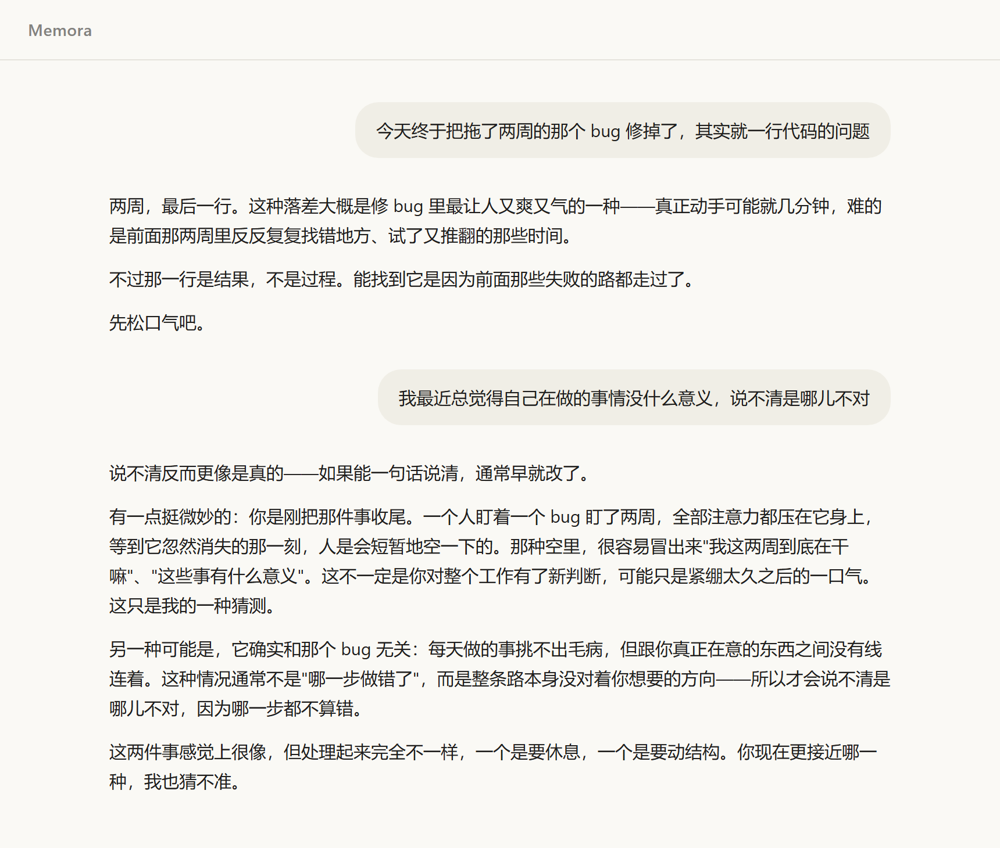
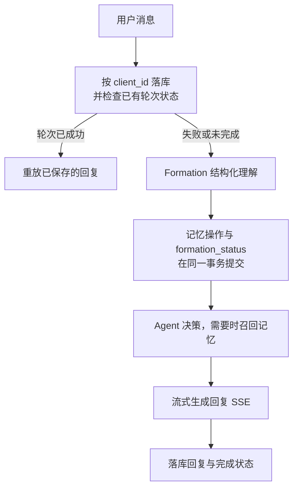

# Memora

Memora 是一个**以长期记忆支撑陪伴与分析的个人 Agent**。它从持续对话中提取用户事实、偏好与目标，支持记忆更新、按需召回与来源追溯，让每次交流都能建立在已有的了解之上。



## 已实现功能

- **自然对话**：回复以 SSE 流式返回，助手回复渲染为 markdown，用户消息始终是纯文本，模型给出的图片与嵌入内容不会被加载。
- **长期记忆**：每轮回复前 Formation 会读最近对话与已有记忆，产出一次结构化理解，并给出形成、确认、替换、纠正四种记忆操作，每条记忆都连着它的原始出处。
- **按需召回**：是否查记忆由模型决定。需要引用过去时它调用 `recall_memories`，核对来源再调 `get_memory_source`，而来源只对本轮召回过的记忆开放。
- **断流恢复**：支持保存部分回复并标注不完整；重试沿用原轮次，不重复新增用户消息。回复成功但记忆处理失败时，可通过恢复接口 `POST /api/chat/formation/recover` 补写。进程被强制终止时，不保证保留尚未落库的输出。
- **日记接口**：`POST /api/journals` 保存日记，抽取摘要与情绪、事件、目标并据此形成记忆；目前只有接口，没有界面。

规划中、尚未实现：记忆管理、状态日历与检索改进。

## 技术栈与核心流程

后端 Go 1.27 + Gin + MySQL，前端 Vue 3 + TypeScript + Vite，模型走 OpenAI 兼容的 `/chat/completions`（默认 DeepSeek）。一条消息进来之后的顺序：



普通的一轮聊天没有工具调用，模型在这条链路上被调用三次：Formation 一次、Agent 决策一次、流式生成一次。三次输入相同、职责不同，Formation 只负责理解发生了什么、要不要动记忆，不负责怎么回复。记忆操作在 Formation 之后就已提交，最后落库的是回复及其完成状态。

**工具召回**是 Agent 决策阶段最多三步的循环：模型要么直接回复，要么返回工具调用；返回调用就执行、把结果作为 tool 消息追加后再问一次。检索是关键词 `LIKE` 匹配，不是向量检索。

**流式回复**是用户实际看到的那次生成。流式接口里决策那轮即使写了正文也会被丢掉，只有流式这次的内容落库；客户端断开时取消一路传下去，`[DONE]` 用来区分正常结束与对端提前断流。

## 本地运行

依赖 Go 1.27（以 `go.mod` 为准）、Node `^18.0.0 || ^20.0.0 || >=22.0.0`（由锁定的 Vite 6.4.3 决定）、MySQL 8，以及一个 OpenAI 兼容的 API Key。

### 1. 配置

`.env` 已在 `.gitignore` 中，不会被提交。Windows 把 `cp` 换成 `copy`，然后填 `DB_PASSWORD` 与 `LLM_API_KEY`。

```bash
cp .env.example .env
```

### 2. 建库并迁移

服务启动**不会**自动跑迁移，需要按编号手动执行一次。

```bash
mysql -u root -p < migrations/001_init.sql
mysql -u root -p memora < migrations/002_chat_message_status.sql
mysql -u root -p memora < migrations/003_chat_turn_idempotency.sql
mysql -u root -p memora < migrations/004_formation_lease.sql
```

`001` 建库 `memora` 与五张表，后三个依次给 `chat_messages` 加回复状态、幂等字段和 Formation 租约。库名写死在 `001` 里，改了 `.env` 的 `DB_NAME` 要同步改它；三个 `ALTER TABLE` 各跑一次即可。

### 3. 启动后端

默认监听 `:8080`。启动时会复核 MySQL 会话时区，与代码里固定的存储时区不一致会直接拒绝启动。

```bash
go run ./cmd/server
```

### 4. 启动前端

开发服务器把 `/api` 代理到 `http://localhost:8080`，所以两个进程都要在跑。

```bash
cd web && npm install && npm run dev
```

## 验证与已知限制

```bash
go build ./... && go vet ./...
go test ./...
cd web && npm run build
```

数据库测试连的是真实 MySQL，由 `MEMORA_TEST_DSN` 开启：

```bash
export MEMORA_TEST_DSN='root:password@tcp(127.0.0.1:3306)/memora_test?charset=utf8mb4&parseTime=true'
go test -count=1 -p 1 ./...
```

所有测试包共用同一个测试库，而每个包的测试进程首次连接时都会 DROP 并重建它，所以必须用 `-p 1` 串行执行测试包；并行跑时，一个进程重建库、逐条跑迁移的窗口里另一个进程正好连上去，就会看到不完整的表结构（如 `Unknown column`）或撞上约束冲突，表现为随机失败。`-count=1` 关掉结果缓存，避免沿用上一次的通过结论。**这是绕过而不是修复，共享库的隔离缺陷仍然存在。** 也不要在跑测试的同时运行另一个使用同一库的测试命令或验收服务。

`-p 1` 只约束测试包之间的并发，不影响 `t.Parallel()`，也不等同于 `-parallel`，所以包内并发行为的测试照常有效。

两条硬规则：**库名必须以 `_test` 结尾**，否则直接报错退出；**测试库的数据会被清空**——每个测试进程首次连接时会 DROP 并重建该库、重跑迁移，此后每个用到测试库的测试开始前会清空 `chat_messages`、`memories`、`memory_sources` 三张表。指向一个非测试库会直接失败，不会降级到开发库。不设置该变量时，这类测试整体跳过。

已知限制：

- 单用户、无鉴权，接口对能访问到端口的人开放。
- 召回是关键词匹配，没有向量检索，换个说法问同一件事可能召回不到，待更新。
- 日记只有接口，没有界面。

## License

[MIT](LICENSE)
