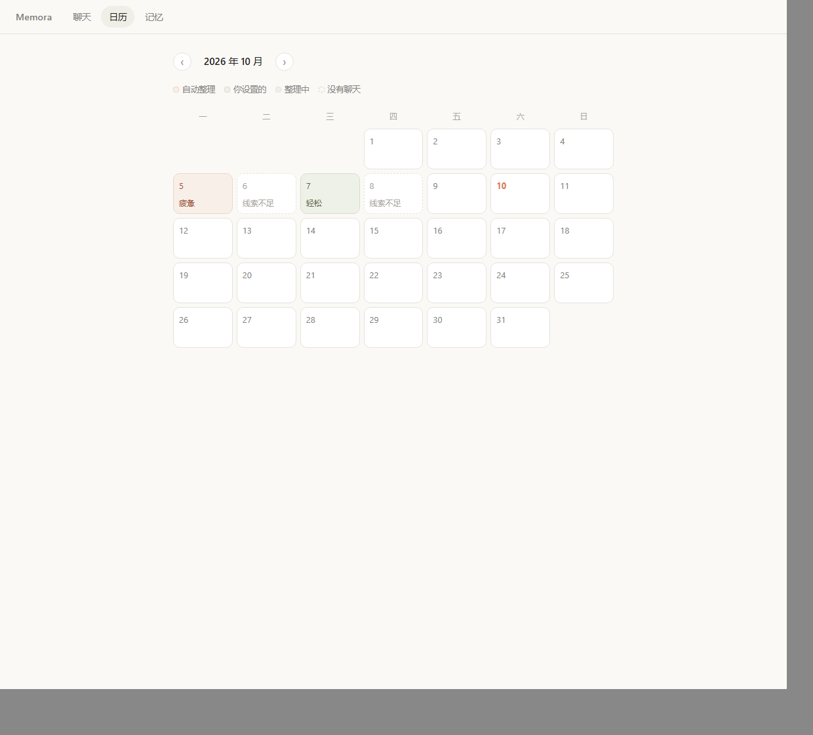
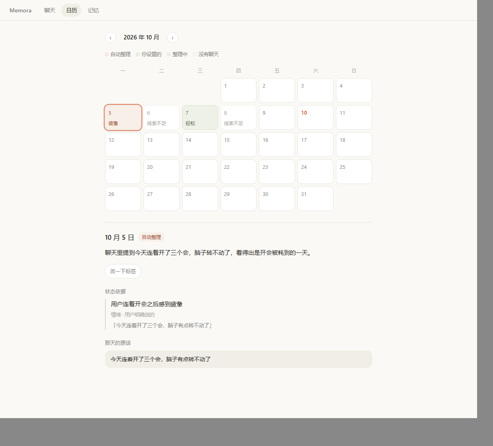
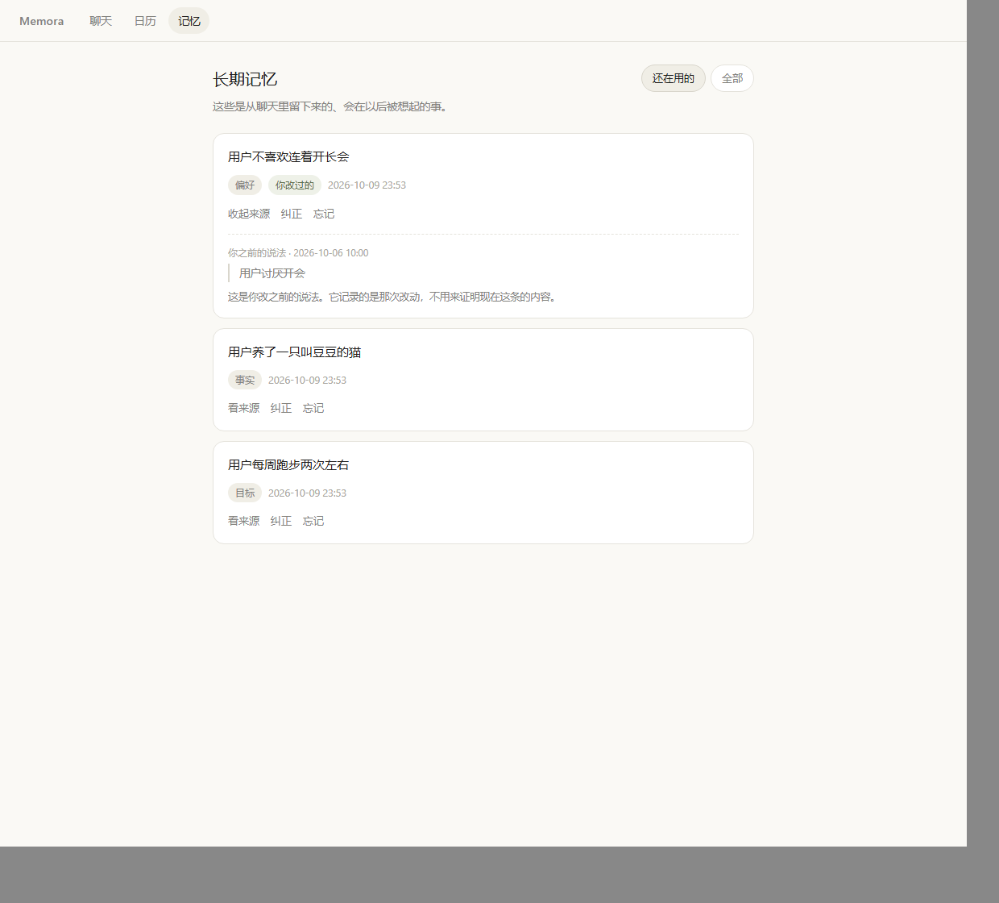
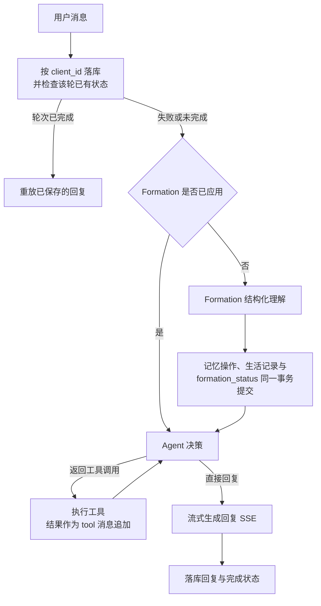

# Memora

<div align="center">


</div>

Memora 是一个面向长期交流的个人记忆 Agent。它从聊天中积累事实、偏好与生活线索，在后续对话中按需回想并追溯依据；你也可以通过状态日历回看每天的状态，查看、纠正或忘记它保存的记忆。

<p align="center">
  
</p>

<p align="center">
  
  
  
</p>

界面分聊天、日历、记忆三页。切换页面不会打断正在生成的回复，输入框里的草稿也不会丢。

## ✨ 核心功能

- **自然对话**：回复以 SSE 流式返回；助手回复渲染为 markdown，用户消息始终按纯文本处理，模型给出的图片与嵌入内容不会被加载。
- **会更新、可追溯的长期记忆**：每轮回复之前，Formation 先从对话里形成、确认、替换或纠正记忆，每条记忆都连着它的原始出处。结合已有记忆识别用户改口，支持替换旧事实或纠正错误，并保留变更关系与来源。
- **按需召回**：是否查历史由模型自己决定，不是每轮都查。要引用过去时调用 `recall_memories`；要核对依据再调 `get_memory_source`，而它只看得到本轮召回过的记忆；要具体事件与日期时调用 `recall_life_records`。三个工具都只读，返回条数有上限，被截断时结果里带 `truncated`。
- **状态日历**：按月看每天的状态。它记的是「那天聊过之后的状态」，不是客观判定——没有聊天的一天是空白，聊过但线索不足的一天如实写「线索不足」，不硬凑一个词。点开某天能看到依据：用到的线索、原话引用、是用户明说还是推测。可以自己改标签，也可以恢复自动，改过的那天会标明是用户设置的。
- **记忆管理**：默认只列仍然有效的记忆，可以切换到全部。每条都能看到内容、分类、状态、时间和它出自哪句话；用户改写过的那条会标明「你改过的」，依据是用户提交的那句，旧原话不会被继续拿来证明它。忘记是软删除：这条不再参与候选、召回和来源读取，重复操作也不会出错，原始聊天与生活记录都保留。

另有两个只提供接口、没有界面的能力：`POST /api/journals` 保存日记并据此形成记忆；`GET /api/life/records` 按内容、日期区间与类型查询带出处的活动、情绪、目标与重要日期。

规划中、尚未实现：主动问候。

## 🧠 技术设计

后端 Go + Gin + MySQL，前端 Vue 3 + TypeScript + Vite，模型走 OpenAI 兼容的 `/chat/completions`。



**Formation 形成与更新记忆。** 每轮回复之前读最近对话与已有记忆，产出一次结构化理解，以及形成、确认、替换、纠正四种记忆操作。送进模型的候选是「最近 12 条 + 用本轮消息检索到的相关若干条」：只给最近若干条，久远但相关的事实就永远进不了输入，用户改口时也无从更新它。检索依据只有当前这条用户消息，不额外增加模型调用，**这不保证所有相关的旧记忆都会进入候选**。

**Agent Loop。** 工具走白名单，参数逐项校验（类型、范围、两种日期口径互斥），并有步数上限：模型要么直接回复，要么返回工具调用；执行后把结果作为 tool 消息追加再问一次，超过上限就停下。

**来源追溯。** 记忆连着产生它的那条消息或日记，`get_memory_source` 只对本轮召回过的记忆开放。用户手动纠正时，新记忆的依据是**用户提交的那次纠正内容本身**；旧聊天不会被拿来证明新内容，旧原话单独列出并标明它证明不了现在这条。

**一致性。** 记忆操作、生活记录与轮次的 `formation_status` 在同一个事务里提交，任一步失败整批回滚；一轮成功后按 `client_id` 重放已保存的回复，不重复新增用户消息；回复成功但记忆处理失败时，可以走 `POST /api/chat/formation/recover` 补写，已经应用过的 Formation 不会重跑。

**记忆检索是字面匹配加相关度排序，不是向量检索。** 记忆召回采用中文二元组与英数分词，经参数化 LIKE 粗筛后按命中词数排序。它改善中文整句查询和相关性排序，但无法覆盖没有字面重合的同义表达；候选数量有限，也不保证所有相关记忆都能进入结果。固定评测与失败样例见 [docs/evaluation.md](docs/evaluation.md)。

**流式回复**是用户实际看到的那次生成，决策那轮即使写了正文也会被丢掉；客户端断开时取消一路传下去，`[DONE]` 用来区分正常结束与对端提前断流。

**关于模型调用成本。** 首次成功且全程没有工具调用的一轮，是三次请求：Formation、Agent 决策、流式生成各一次。Formation 已经应用过、只是重试回复时是两次；已完成并被重放的轮次是零次。工具循环每多走一轮就多一次决策请求，HTTP 层的重试也会额外增加请求开销。其中有一项固定的浪费：决策那一步模型写出的正文会被丢掉、由流式那次重写一遍。

打开日历页同理：读月份的接口不调用模型，但页面会为当月「有聊天、有线索、尚未整理」的那些日期逐个发起整理，每个一次；已经有有效结果、输入也没变的会复用，不会重复调用。

## 🚀 本地运行

依赖 Go 1.27（见 `go.mod`）、Node `^18.0.0 || ^20.0.0 || >=22.0.0`（由 Vite 6 决定）、MySQL 8，以及一个 OpenAI 兼容的 API Key。

### 1. 配置

`.env` 已在 `.gitignore` 中，不会被提交。Windows 把 `cp` 换成 `copy`，然后填 `DB_PASSWORD` 与 `LLM_API_KEY`。

```bash
cp .env.example .env
```

### 2. 建库并建表

服务启动**不会**自动建表。先建库，再明确对这个库执行初始化：`001_schema.sql` 只描述表结构，不带 `create database` / `use`，导入到哪个库完全由命令决定。库名要与 `.env` 里的 `DB_NAME` 一致。

```bash
mysql -u root -p -e "create database memora character set utf8mb4"
mysql -u root -p memora < migrations/001_schema.sql
```

项目还在开发阶段，**结构变更直接改 `001_schema.sql`，不维护旧版本的升级脚本**。已经有数据的库要跟上新结构，确认可以丢弃后重建一次即可：

```bash
mysql -u root -p -e "drop database memora; create database memora character set utf8mb4"
mysql -u root -p memora < migrations/001_schema.sql
```

**上述重建操作会删除已有数据，只在确认可以丢弃该库时执行**；个人的开发库不会被任何测试或脚本自动重建。

### 3. 启动后端

默认监听 `:8080`。启动时会复核 MySQL 会话时区，与代码里固定的存储时区不一致会直接拒绝启动。

```bash
go run ./cmd/server
```

### 4. 启动前端

开发服务器把 `/api` 代理到 `http://localhost:8080`，所以两个进程都要在跑。

```bash
cd web && npm install && npm run dev
```

## ✅ 验证与关键限制

```bash
go build ./... && go vet ./...
go test ./...
cd web && npm run build
```

数据库测试连的是真实 MySQL，由 `MEMORA_TEST_DSN` 开启：

```bash
export MEMORA_TEST_DSN='root:password@tcp(127.0.0.1:3306)/memora_test?charset=utf8mb4&parseTime=true'
go test -count=1 -p 1 ./...
```

三点要注意：

- **必须指向一个独立的测试库，它的数据会被清空。** 库名要以 `_test` 结尾，否则直接报错退出，不会降级到开发库；不设置 `MEMORA_TEST_DSN` 时，需要数据库的测试整体跳过。测试库不存在也能直接跑全量，测试会先把库建出来。
- **多个测试包共用一个测试库时要加 `-p 1`**，串行执行测试包。
- **需要在线模型的核查默认跳过，必须显式开启，跳过不算通过。**

```bash
MEMORA_REALCHECK=1 go test -count=1 -p 1 ./internal/service -run 'TestReal|TestFormationSamples' -v
```

测试库隔离、清表顺序、跳过项，以及检索与 Formation 候选的固定评测数据、旧新对比和未解决样例，都记在 [docs/evaluation.md](docs/evaluation.md)。

关键限制：

- 单用户、无鉴权，所有接口对能访问到端口的人开放。
- 召回是字面匹配，没有向量检索，换个说法问同一件事可能召回不到。检索按个人量级设计（一次查询最多拆 16 个词、粗筛最多取 200 条候选），不是为大规模检索做的。
- 模型提取与状态标签都可能出错：生活记录的校验只保证内部一致与有出处可回溯，不保证语义提取正确；日历标签是线索的概括而不是判定，同一天重复整理可能给出不同的词，可以随时自己改，改过的以你为准。
- 界面在窄屏（<640px）下做过一次实际渲染检查，但没有在真机上试过，触屏的点击区域与滚动惯性未验证。

## 📄 License

[MIT](LICENSE)
